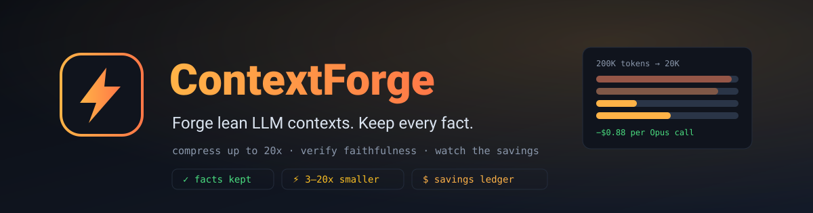
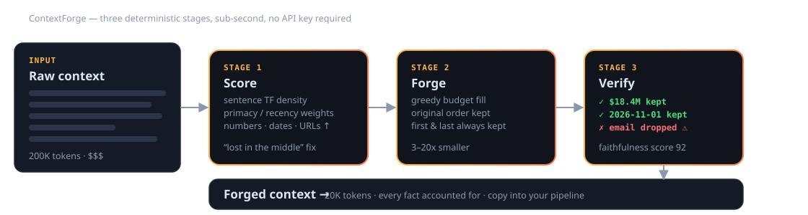
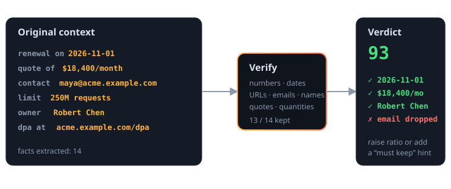

<p align="center">
  
</p>

# ContextForge

**Prompt compression with a receipt.** ContextForge takes giant LLM prompts — support
threads, transcripts, RAG piles, repo dumps — forges them down to a fraction of the
size, and **proves nothing important was lost** before you ship them.

- ⚡ **3–20× smaller contexts** — deterministic extractive engine, free and offline
- 🛡️ **Faithfulness verification** — every number, date, URL, email and name is checked; anything dropped is flagged by severity
- 💸 **Savings ledger** — live per-call dollar savings computed against current model pricing
- 🤖 **Optional LLM engine** — bring your own OpenRouter key for LLM-grade compression; falls back to extractive automatically
- 📦 **Zero dependencies** — pure Node ≥18, single container, one-command Railway deploy

---

## Why this exists

Two research findings and one market fact:

1. **Long contexts degrade quality, not just cost.** *Lost in the Middle*
   (Liu et al., TACL 2023) showed models reliably ignore information buried
   mid-context. *RULER* (Hsieh et al., COLM 2024) found only half of evaluated
   "long-context" models maintained satisfactory performance even at 32K tokens.
2. **20× compression is proven.** *LLMLingua* (Jiang et al., EMNLP 2023)
   demonstrated up to 20× prompt compression with little performance loss.
3. **The math is absurdly favorable.** At current pricing (~$5/M input for
   frontier models), compressing a 200K-token prompt 10× saves **$0.88 per call**.
   A $0.10/M compressor model doing that job costs ~$0.03. The free extractive
   engine costs nothing at all.

What was missing is a tool that makes compression **trustworthy** — not just
smaller, but *verified*. That's ContextForge.

📖 Full research notes: [`docs/research.md`](docs/research.md) ·
📋 Product requirements: [`docs/PRD.md`](docs/PRD.md)

---

## How it works

<p align="center">
  
</p>

| Stage | What happens |
|---|---|
| **1 · Score** | Your context is split into sentences and scored by information density, with primacy/recency weighting — a direct counter to the *Lost in the Middle* effect. |
| **2 · Forge** | Fact-dense sentences fill your token budget first, in original order. First and last sentences are always kept. |
| **3 · Verify** | Every checkable fact in the original is matched against the forged output. Missing facts are appended as a key-facts appendix (guarantee) and any remainder is flagged by severity. |

<p align="center">
  
</p>

---

## Quick start

```bash
git clone https://github.com/adventurewave-labs/contextforge.git
cd contextforge
npm start          # no npm install needed — zero dependencies
open http://localhost:3000
```

Optional — enable the LLM compression engine:

```bash
export OPENROUTER_API_KEY=sk-or-...   # any OpenRouter key
npm start
```

### Deploy to Railway

1. Push this repo to your GitHub.
2. In Railway: **New Project → Deploy from GitHub repo**.
3. Done — `railway.json` configures the Dockerfile build and `/health` check.
   Optionally set `OPENROUTER_API_KEY` as a service variable.

Or with the CLI:

```bash
railway init && railway up
```

---

## API

### `POST /api/compress`

```json
{
  "context": "<your giant prompt text>",
  "targetRatio": 0.3,
  "engine": "extractive",
  "instructions": "renewal dates, pricing, customer names",
  "model": "anthropic/claude-haiku-5.5"
}
```

```json
{
  "jobId": "b7f6…",
  "originalTokens": 612,
  "compressedTokens": 204,
  "ratio": 0.333,
  "compression": 3.0,
  "method": "extractive",
  "elapsedMs": 6,
  "fallbackReason": null,
  "compressed": "Acme Corp reported revenue of $18.4 million…"
}
```

- `engine`: `"extractive"` (default, free) or `"llm"` (uses `OPENROUTER_API_KEY`;
  `model` defaults to `anthropic/claude-haiku-5.5`). Any LLM failure falls back to
  extractive automatically and says so in `fallbackReason`.
- `instructions`: free-text "must keep" hints — sentences matching ≥2 of your
  keywords get pinned.

### `POST /api/verify`

```json
{ "original": "<full text>", "compressed": "<forged text>" }
```

```json
{
  "score": 93,
  "factsTotal": 14,
  "factsKept": 13,
  "missing": [{ "value": "maya@acme.example.com", "kind": "email", "severity": "medium" }]
}
```

Score is severity-weighted: dropping a date or dollar figure hurts more than
dropping a passing mention of a name.

### `GET /api/models` · `GET /api/stats` · `GET /health`

Model catalog with live pricing snapshot · lifetime forge stats · healthcheck.

---

## The UI

Paste (or **Load sample**), drag the target-size slider, hit **Forge context**:

- Before/after panels with token counts and compression ratio
- Faithfulness meter with missing-fact chips, colored by severity
- Per-call savings table across six popular models
- Copy button, engine/model pickers, "must keep" hint field

Everything runs server-side; no accounts, no tracking, no external calls
unless you enable the LLM engine.

---

## Design decisions

- **Zero npm dependencies.** The whole server is Node stdlib. Smaller attack
  surface, instant cold starts, nothing to audit.
- **Verification is deterministic.** The faithfulness check doesn't ask an LLM
  whether it did a good job — it extracts checkable facts and checks them.
- **Compression guarantees facts.** High/medium-severity facts not covered by
  selected sentences are appended as a compact key-facts appendix rather than
  silently dropped.
- **Sentence granularity, order preserved.** Forged context stays readable and
  stays in narrative order — models handle ordered, coherent context better
  than shuffled fragments.
- **Ephemeral by design.** No database, no stored prompts. Stats are anonymous
  counters. Your context leaves memory when the request ends.

---

## Tests

```bash
npm test    # 18 tests, zero dependencies
```

---

## Roadmap

- [ ] SQLite persistence + shareable result links
- [ ] Token-level LLMLingua-style compression behind the same API
- [ ] Team savings ledgers + CSV export
- [ ] Drop-in OpenAI-compatible proxy that forges context transparently

## License

MIT © Adventurewave Labs

## Credits

Research grounding: *Lost in the Middle* (Liu et al., TACL 2023) · *RULER*
(Hsieh et al., COLM 2024) · *LLMLingua* (Jiang et al., EMNLP 2023). Pricing
snapshot from the OpenRouter catalog (2026-10-12).
